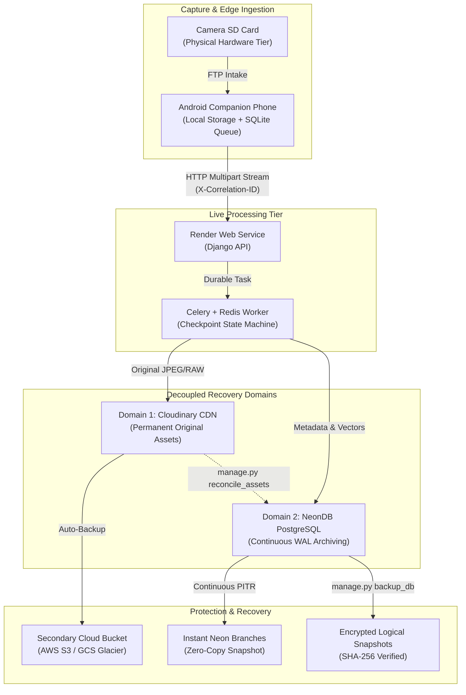
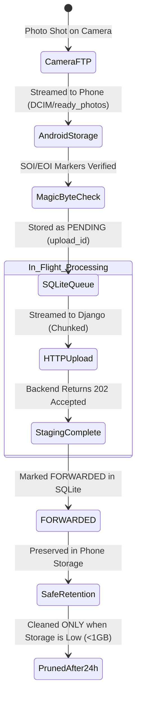

# Backup & Disaster Recovery Strategy
**Live Wedding Gallery — Enterprise Continuity & Data Protection Architecture**

---

## 1. Executive Summary & Core Principles

The Live Wedding Gallery operates on a strict **Decoupled Storage & Metadata Architecture**:

> [!IMPORTANT]
> **Independent Recovery Domains:**
> Database backups **DO NOT** back up Cloudinary images, and Cloudinary storage **DO NOT** back up relational metadata. Database metadata (NeonDB) and image binaries (Cloudinary CDN) are treated as separate, parallel recovery responsibilities with independent Recovery Point Objectives (RPO) and Recovery Time Objectives (RTO).



---

## 2. Recovery Objectives (RPO & RTO)

| System Domain | Recovery Point Objective (RPO) | Recovery Time Objective (RTO) | Primary Recovery Mechanism | Secondary Fallback |
| :--- | :---: | :---: | :--- | :--- |
| **NeonDB Relational Metadata** | **$\le 5$ minutes** | **$\le 5$ minutes** | Neon Continuous WAL Point-in-Time Restore (PITR) / Branching | `python manage.py restore_db` from gzip snapshot |
| **Cloudinary Original Images** | **0 (Zero Loss)** | **$\le 10$ minutes** | Cloudinary CDN with immutable originals & versioning | Secondary automated cloud backup bucket (AWS S3 / GCS) |
| **Android In-Flight Uploads** | **0 (Zero Loss)** | **$\le 2$ minutes** | Android SQLite `ready_photos/` retention until forward confirmation | Camera physical SD card re-read |
| **Render Web & Worker Services** | **$\le 1$ minute** | **$\le 3$ minutes** | Automated Docker container restart / Git auto-deploy on Render | Manual redeploy via `render.yaml` blueprint |
| **Face Recognition Embeddings** | **$\le 5$ minutes** | **$\le 15$ minutes** | Re-extracted automatically from Cloudinary CDN 1200px previews | Restored from NeonDB `faces_face` table backup |

---

## 3. Domain 1: NeonDB Backup & Point-in-Time Restore (PITR)

### 3.1 Neon Native Capabilities by Plan
Neon PostgreSQL separates compute from storage using an immutable Write-Ahead Log (WAL) architecture:

| Neon Plan Tier | Continuous PITR Retention | Point-in-Time Branching | High Availability / SLA | Disaster Recovery Approach |
| :--- | :---: | :---: | :---: | :--- |
| **Free Tier** | Up to 24 hours | Supported (up to 10 branches) | Best-effort | Create PITR branch before maintenance; daily logical export |
| **Launch Tier (\$19/mo)** | **7 days** | Unlimited branches | 99.95% | Instant PITR branch creation to any millisecond in past 7 days |
| **Scale Tier (\$69/mo)** | **30 days** | Unlimited branches | 99.99% | Instant 30-day point-in-time rewind, zero data loss guarantee |

### 3.2 Instant Point-in-Time Branching (Zero-Copy Recovery)
If accidental data modification or corruption occurs:
1. Identify the exact UTC timestamp prior to the incident (e.g. `2026-11-21T14:32:00Z`).
2. Create an instant branch using the Neon CLI:
   ```bash
   neonctl branches create \
     --name recovery-branch-20261121 \
     --point-in-time "2026-11-21T14:32:00Z" \
     --parent main
   ```
3. Update `DATABASE_URL` in Render environment settings to point to the new branch endpoint. The database is restored in **under 30 seconds** with zero storage duplication.

### 3.3 Automated Logical Snapshots (`manage.py backup_db`)
In addition to Neon's cloud-managed WAL archiving, the project includes an automated logical snapshot generator:
- **Command:** `python backend/manage.py backup_db`
- **Output:** Gzip-compressed fixture `backups/full_db_YYYYMMDD_HHMMSSZ_scheduled.json.gz`.
- **Integrity:** Automatically computes and writes a sidecar `.sha256` checksum file.
- **Manifest:** Records table row counts (`Wedding`, `Photo`, `Face`, `IngestionJob`, `PhoneDevice`, `Transfer`, `User`, `Token`).
- **Pruning:** Automatically prunes local snapshots older than `--prune-older-than-days 30`.

```powershell
# Create an on-demand pre-event snapshot
python backend/manage.py backup_db --tag pre-wedding-rehearsal

# Verify archive integrity without modifying the database (Dry-Run)
python backend/manage.py restore_db --backup-file backend/backups/full_db_20261105_011649Z_pre-wedding-rehearsal.json.gz --dry-run
```

---

## 4. Domain 2: Cloudinary Original Image Protection & Asset Recovery

### 4.1 Strict Policy: Preservation of Originals
- **Predictable Idempotent Hierarchy:** Cloudinary public IDs follow `weddings/{wedding_slug}/{folder}/{YYYY-MM-DD}/{checksum[:16]}`.
- **Never Overwrite with Transformed Images:** Dynamic image transformations (`f_auto,q_auto,w_400`) are computed on the CDN edge and delivered to guests without modifying the original high-resolution master asset stored in Cloudinary.
- **Full-Resolution Downloads:** The `download_url` property forces direct download of the original uncompressed file with content disposition attachment:
  ```python
  get_download_url(self.cloudinary_public_id, self.format, self.original_filename)
  ```

### 4.2 Cloudinary Deletion Protection & Backup Options
1. **Automated Secondary Cloud Backup (Customer-Owned S3/GCS):**
   - In Cloudinary Console: Navigate to **Settings $\to$ Upload $\to$ Backup**.
   - Enable **Automatic Backup** and connect a dedicated private AWS S3 bucket or Google Cloud Storage bucket (`s3://live-wedding-gallery-cold-backup/`).
   - Every photograph uploaded to Cloudinary is automatically mirrored to the cold-storage bucket in real time.
2. **Asset Versioning:**
   - Cloudinary maintains version numbers for every public ID (`v1730784000/...`). Even if a photo is re-uploaded with identical name, previous versions remain accessible in Cloudinary storage.
3. **Media Library Trash (Soft Delete):**
   - Cloudinary retains deleted assets in the **Trash** for **30 to 90 days** (depending on plan tier). Accidental deletions can be restored directly via Cloudinary Media Library with one click.
4. **Restricted Admin API Credentials:**
   - The production backend uses environment-injected API credentials. Destructive delete calls (`cloudinary.uploader.destroy`) are strictly restricted in application code.

### 4.3 Isolation of Ordinary Cleanup Jobs
> [!CAUTION]
> **Cloudinary Assets are Protected from Routine Maintenance:**
> - `cleanup_stale_data.py` only prunes old `IngestionJob` and `Transfer` database rows and local temporary files in `staging_uploads/`. It **NEVER** calls Cloudinary's `destroy()` API.
> - `StorageMonitor.kt` on Android only cleans local cache copies from `ready_photos/` after successful HTTP confirmation. It **NEVER** deletes remote Cloudinary assets.
> - Container restart cleanup only purges ephemeral staging files on Render local disk after Cloudinary upload confirmation.

---

## 5. Domain 3: Android Companion App & Hardware Recovery

The Android companion phone serves as the primary resilient buffer between the camera's wireless FTP transfer and the cloud backend.



### 5.1 Handling Interrupted Transfers & Device Restarts
- **Persistent SQLite Database:** Every image is tracked in `UploadQueueDatabase` with status `PENDING`, `UPLOADING`, `FORWARDED`, or `FAILED`.
- **Process Crash / Phone Reboot:** If the companion app crashes or the battery dies while streaming:
  - On next service launch, `UploadManager.resetStuckUploadingToPending()` automatically resets all `UPLOADING` records to `PENDING`.
  - The queue automatically resumes streaming from where it left off with exponential backoff ($5\text{s}, 10\text{s}, 20\text{s}, 40\text{s}, 80\text{s}, 160\text{s}$).
- **Disk Space Protection:** `StorageMonitor.getStorageStatus()` continuously measures available flash storage. If free storage drops below $1\text{GB}$, it safely deletes only files marked `FORWARDED`, never files in `PENDING` or `FAILED` state.
- **Worst-Case Hardware Failure:** If the Android phone is dropped, submerged, or destroyed, the physical camera SD card retains all original RAW/JPEG photographs. A replacement Android device can be provisioned in under 5 minutes by scanning the camera's Wi-Fi QR code.

---

## 6. Domain 4: Configuration & Deployment Protection

The following repository assets are version-controlled and protected to ensure the entire infrastructure can be recreated from scratch on any host within 15 minutes:

1. **Service Blueprint (`backend/render.yaml`):** Defines web service, background Celery workers, Redis instance, environment bindings, disk mounts, and health check endpoints.
2. **Container Definition (`backend/Dockerfile` & `build.sh`):** Pins exact Python 3.13 packages, OpenCV, InsightFace ONNX models, and Gunicorn/Uvicorn ASGI configurations.
3. **Database Migration Graph (`backend/*/migrations/`):** Complete, linear schema migrations including pgvector HNSW index specifications.
4. **Environment Secret Template (`.env.example`):** Documents all required production keys (`DATABASE_URL`, `CLOUDINARY_*`, `REDIS_URL`, `SECRET_KEY`).
5. **Frontend Build Pipeline (`frontend/package.json` & `vite.config.ts`):** Deterministic bundling with vendor chunking.

---

## 7. Reconciling Cloudinary Assets with NeonDB

If a severe database failure or un-checkpointed transaction rollback occurs, Cloudinary may hold thousands of photographs that are missing from NeonDB.

The project includes an operational reconciliation engine:
- **Command:** `python backend/manage.py reconcile_assets --wedding <slug>`
- **Detection:**
  - `MATCHED`: Verified present in both Cloudinary and NeonDB.
  - `ORPHANS_IN_CLOUDINARY`: Master image present on Cloudinary CDN, but database record is missing.
  - `MISSING_IN_CLOUDINARY`: Database record exists, but CDN asset returns 404.
- **Auto-Restoration (`--auto-restore-orphans`):** Recreates missing `Photo` rows in NeonDB using Cloudinary asset metadata (dimensions, format, secure URL, creation date), infers the folder hierarchy from the public ID, and automatically enqueues background face embedding extraction.

```powershell
# 1. Inspect discrepancy report without changing data (Dry-Run)
python backend/manage.py reconcile_assets --wedding sandeep-prathyusha --dry-run --output-json reconcile_audit.json

# 2. Recreate missing NeonDB records from Cloudinary master assets
python backend/manage.py reconcile_assets --wedding sandeep-prathyusha --auto-restore-orphans
```

---

## 8. Disaster Recovery Playbooks

### Playbook A: Total NeonDB Database Loss or Dropped Schema
1. **Acknowledge Outage:** Observability raises `DB_CONNECTION_FAILURE` alert.
2. **Execute Neon Point-in-Time Restore:**
   - In Neon Console: Open Branches $\to$ Click **Create Branch from Point in Time**.
   - Select 2 minutes prior to incident.
   - Copy the new branch pooled connection string.
3. **Update Render Environment:**
   - Set `DATABASE_URL` in Render Dashboard $\to$ Environment Variables.
   - Render automatically triggers zero-downtime rolling restart.
4. **Run Asset Reconciliation:**
   ```bash
   python backend/manage.py reconcile_assets --wedding sandeep-prathyusha --auto-restore-orphans
   ```
5. **Verify Health:** Verify `GET /api/health/` returns HTTP 200.

---

### Playbook B: Accidental Bulk Photo Deletion in Gallery
1. **Check Cloudinary Media Library Trash:**
   - Open Cloudinary Console $\to$ Media Library $\to$ **Trash**.
   - Select the wedding folder (`weddings/sandeep-prathyusha/`) and click **Restore**.
2. **Restore Database Records:**
   - Run the reconciliation tool with auto-restore:
     ```bash
     python backend/manage.py reconcile_assets --wedding sandeep-prathyusha --auto-restore-orphans
     ```
   - Recreated photos immediately become visible in the gallery and have face vectors re-indexed.

---

### Playbook C: Render Web/Worker Instance Host Crash
1. **Render Automatic Recovery:** Render edge routers automatically spin up a replacement container within 60 to 90 seconds.
2. **Automatic Job Recovery:** At container startup, `resume_interrupted_jobs()` executes automatically:
   - Identifies jobs left in `UPLOADING` or `QUEUED` state.
   - If `cloudinary_public_id` was already assigned, resumes database registration.
   - If staging file was lost before Cloudinary upload, marks job `FAILED` so the Android companion app re-transmits it immediately.
3. **No Photo Loss:** Zero accepted photos are lost.

---

## 9. Verification & Staging Drill Commands

To verify that disaster recovery procedures work before live wedding events, run the automated staging drill:

```powershell
# 1. Run Complete Staging Restoration Rehearsal (Measures simulated RTO)
$env:PYTHONPATH="backend"
python backend/manage.py test_restore_staging

# 2. Run Full Automated Test Suite (71 Tests)
python -m unittest photos.tests weddings.tests faces.tests photos.test_queue photos.test_security weddings.test_capacity test_integration_lifecycle observability.tests photos.test_backup_recovery
```
