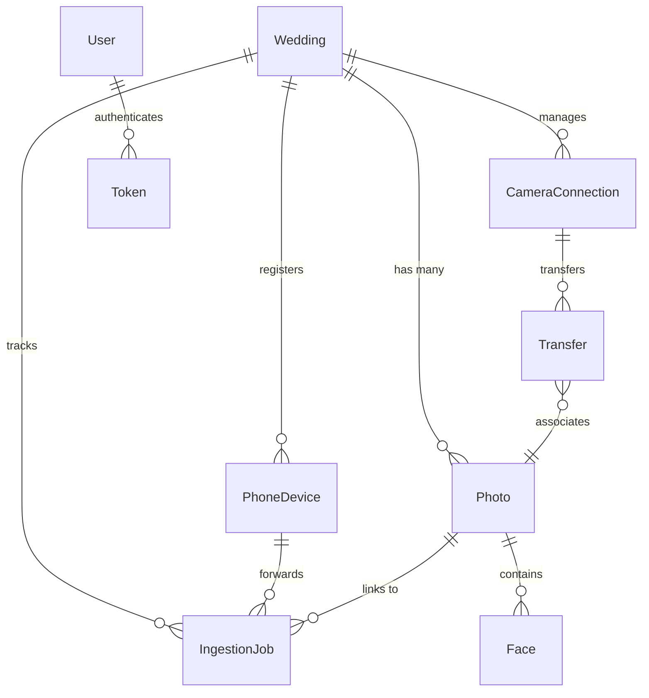
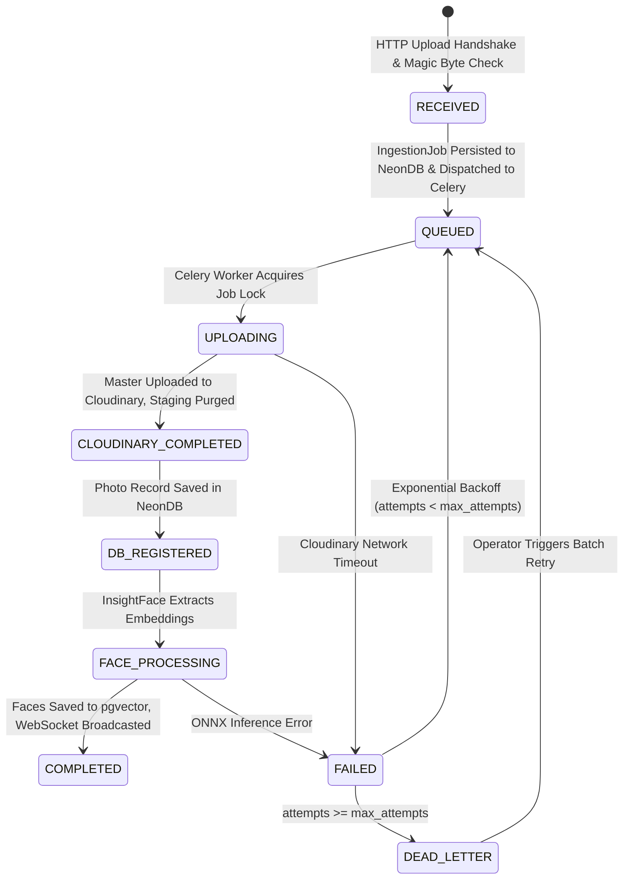

# Database Schema & Data Dictionary
**Live Wedding Gallery — NeonDB PostgreSQL & pgvector**

This document specifies the relational database schema, data types, indexes, and vector configurations powering the Live Wedding Gallery.

---

## 1. Database Infrastructure

- **Engine**: PostgreSQL 16+ on **Neon Serverless**.
- **Pooling**: **PgBouncer** (Transaction pooling mode on port 5432/6543, pooler endpoint `-pooler`).
- **Extensions**:
  - `vector` (`pgvector` for 512-dimensional facial embedding storage and cosine similarity indexing).
- **Django Configuration**:
  - `DISABLE_SERVER_SIDE_CURSORS = True` (Mandatory for PgBouncer transaction mode).
  - `conn_max_age = 60` (Maintains warm connection pool while allowing graceful scaling).
  - `conn_health_checks = True` (Validates connection readiness to transparently handle Neon scale-to-zero wakeups).

---

## 2. Entity Relationship Overview



---

## 3. Detailed Data Dictionary

### 3.1 `weddings_wedding`
Stores top-level wedding events, dates, venue metadata, and optional VIP couple reference face embeddings.

| Column | Data Type | Constraints | Description |
| :--- | :--- | :--- | :--- |
| `id` | `BIGINT` | `PRIMARY KEY GENERATED ALWAYS AS IDENTITY` | Auto-increment primary key. |
| `slug` | `VARCHAR(100)` | `UNIQUE NOT NULL` | URL-friendly wedding identifier (e.g., `sandeep-prathyusha`). |
| `bride_name` | `VARCHAR(100)` | `NOT NULL` | Bride's name. |
| `groom_name` | `VARCHAR(100)` | `NOT NULL` | Groom's name. |
| `wedding_title`| `VARCHAR(200)` | `DEFAULT ''` | Custom title (e.g. "Sandeep & Prathyusha's Wedding"). |
| `wedding_date` | `DATE` | `NOT NULL` | Date of the wedding. |
| `venue` | `VARCHAR(200)` | `DEFAULT ''` | Wedding venue location. |
| `description` | `TEXT` | `DEFAULT ''` | Narrative / welcome message for guests. |
| `cover_image` | `VARCHAR(500)` | `DEFAULT ''` | Cloudinary URL for header banner. |
| `bride_embedding`| `vector(512)`| `NULL` | 512-dimensional normalized facial embedding of the bride. |
| `groom_embedding`| `vector(512)`| `NULL` | 512-dimensional normalized facial embedding of the groom. |
| `is_active` | `BOOLEAN` | `DEFAULT TRUE` | Whether the gallery is publicly active. |
| `created_at` | `TIMESTAMPTZ` | `DEFAULT NOW()` | Record creation timestamp. |
| `updated_at` | `TIMESTAMPTZ` | `DEFAULT NOW()` | Last update timestamp. |

---

### 3.2 `photos_photo`
Represents an individual wedding photo stored in Cloudinary and published in the guest gallery.

| Column | Data Type | Constraints | Description |
| :--- | :--- | :--- | :--- |
| `id` | `BIGINT` | `PRIMARY KEY GENERATED ALWAYS AS IDENTITY` | Primary key. |
| `wedding_id` | `BIGINT` | `FOREIGN KEY (weddings_wedding.id) ON DELETE CASCADE` | Associated wedding. |
| `original_filename`| `VARCHAR(255)`| `NOT NULL` | Camera filename (e.g. `DSC01928.JPG`). |
| `cloudinary_public_id`| `VARCHAR(255)`| `NULL` | Cloudinary asset public ID. |
| `cloudinary_url` | `VARCHAR(500)` | `NULL` | Direct Cloudinary HTTP asset URL. |
| `secure_url` | `VARCHAR(500)` | `NULL` | Direct Cloudinary HTTPS asset URL. |
| `thumbnail_url`| `VARCHAR(500)` | `NULL` | Pre-computed or custom thumbnail URL. |
| `width` | `INTEGER` | `NULL` | Image width in pixels. |
| `height` | `INTEGER` | `NULL` | Image height in pixels. |
| `file_size` | `BIGINT` | `NULL` | Image size in bytes. |
| `format` | `VARCHAR(20)` | `NULL` | File extension/format (`jpg`, `webp`, `avif`). |
| `resource_type`| `VARCHAR(20)` | `DEFAULT 'image'` | Cloudinary resource classification. |
| `folder` | `VARCHAR(100)` | `DEFAULT 'Uncategorized'` | Album sub-folder (`Ceremony`, `Reception`, etc.). |
| `checksum` | `VARCHAR(64)` | `NULL, INDEXED` | SHA-256 hex digest of original image binary. |
| `processing_status`| `VARCHAR(20)`| `DEFAULT 'PENDING'` | Lifecycle: `PENDING`, `PROCESSING`, `COMPLETED`, `FAILED`. |
| `upload_status`| `VARCHAR(20)` | `DEFAULT 'PENDING'` | Upload progress indicator. |
| `captured_at` | `TIMESTAMPTZ` | `NULL` | EXIF capture timestamp. |
| `uploaded_at` | `TIMESTAMPTZ` | `DEFAULT NOW()` | Time uploaded to backend. |
| `created_at` | `TIMESTAMPTZ` | `DEFAULT NOW()` | Database insertion timestamp. |

**Indexes on `photos_photo`**:
* `(wedding_id, checksum)`: Deduplication check index.
* `(wedding_id, processing_status, -created_at, -id)`: High-performance gallery pagination index.
* `(wedding_id, folder, processing_status, -created_at, -id)`: High-performance folder-filtered gallery index.
* `(wedding_id, -created_at, -id)`: Stable keyset & offset pagination index.

---

### 3.3 `faces_face`
Stores detected face bounding boxes and 512-dimensional facial embeddings extracted by InsightFace ArcFace.

| Column | Data Type | Constraints | Description |
| :--- | :--- | :--- | :--- |
| `id` | `BIGINT` | `PRIMARY KEY GENERATED ALWAYS AS IDENTITY` | Primary key. |
| `photo_id` | `BIGINT` | `FOREIGN KEY (photos_photo.id) ON DELETE CASCADE` | Source photo containing the face. |
| `embedding` | `vector(512)` | `NOT NULL` | ArcFace 512-d normalized facial feature vector. |
| `x` | `FLOAT` | `NOT NULL` | Normalized bounding box X coordinate ($0.0$ to $1.0$). |
| `y` | `FLOAT` | `NOT NULL` | Normalized bounding box Y coordinate ($0.0$ to $1.0$). |
| `width` | `FLOAT` | `NOT NULL` | Normalized bounding box width. |
| `height` | `FLOAT` | `NOT NULL` | Normalized bounding box height. |
| `detection_confidence`| `FLOAT` | `NOT NULL` | Model confidence score ($0.0$ to $1.0$). |
| `created_at` | `TIMESTAMPTZ` | `DEFAULT NOW()` | Timestamp of embedding extraction. |

**pgvector HNSW Index on `faces_face`**:
```sql
CREATE INDEX faces_face_emb_hnsw_idx ON faces_face 
USING hnsw (embedding vector_cosine_ops) 
WITH (m = 16, ef_construction = 64);
```
* **Metric**: Cosine distance (`vector_cosine_ops`).
* **HNSW Parameters**: `m = 16` links per node, `ef_construction = 64` build depth. Enables sub-10ms nearest-neighbor face retrieval across 100,000+ faces.

---

### 3.4 `photos_ingestionjob`
Provides durable asynchronous task tracking, state recovery, and dead-letter queue management.

| Column | Data Type | Constraints | Description |
| :--- | :--- | :--- | :--- |
| `job_id` | `UUID` | `PRIMARY KEY` | Unique UUIDv4 job identifier. |
| `upload_id` | `VARCHAR(255)` | `NULL, INDEXED` | Correlation identifier from client/Android. |
| `wedding_id` | `BIGINT` | `FOREIGN KEY (weddings_wedding.id) ON DELETE CASCADE` | Associated wedding. |
| `device_id` | `BIGINT` | `FOREIGN KEY (photos_phonedevice.id) ON DELETE SET NULL` | Originating Android companion device. |
| `photo_id` | `BIGINT` | `FOREIGN KEY (photos_photo.id) ON DELETE SET NULL` | Created Photo record (upon registration). |
| `original_filename`| `VARCHAR(255)`| `NOT NULL` | Original filename from camera/device. |
| `staging_path` | `VARCHAR(500)` | `NULL` | Ephemeral path on local `/tmp` staging volume. |
| `folder` | `VARCHAR(100)` | `DEFAULT 'Uncategorized'` | Category folder. |
| `checksum` | `VARCHAR(64)` | `NOT NULL, INDEXED` | SHA-256 checksum for deduplication. |
| `file_size` | `BIGINT` | `DEFAULT 0` | File size in bytes. |
| `mime_type` | `VARCHAR(100)` | `DEFAULT 'image/jpeg'` | MIME type verified via magic bytes. |
| `status` | `VARCHAR(30)` | `NOT NULL, INDEXED` | State: `RECEIVED`, `QUEUED`, `UPLOADING`, `CLOUDINARY_COMPLETED`, `DB_REGISTERED`, `FACE_PROCESSING`, `COMPLETED`, `FAILED`, `DEAD_LETTER`. |
| `attempts` | `INTEGER` | `DEFAULT 0` | Number of execution attempts. |
| `max_attempts` | `INTEGER` | `DEFAULT 5` | Maximum retries before dead-lettering. |
| `cloudinary_public_id`| `VARCHAR(255)`| `NULL` | Checkpoint: Cloudinary public ID. |
| `cloudinary_url` | `VARCHAR(500)` | `NULL` | Checkpoint: Cloudinary URL. |
| `secure_url` | `VARCHAR(500)` | `NULL` | Checkpoint: Cloudinary secure URL. |
| `image_width` | `INTEGER` | `NULL` | Checkpoint: Image width. |
| `image_height` | `INTEGER` | `NULL` | Checkpoint: Image height. |
| `format` | `VARCHAR(20)` | `NULL` | Checkpoint: Format. |
| `resource_type`| `VARCHAR(20)` | `DEFAULT 'image'` | Checkpoint: Resource type. |
| `last_error` | `TEXT` | `NULL` | Error message and traceback from last failure. |
| `dead_letter_reason`| `TEXT` | `NULL` | Reason job was moved to dead-letter queue. |
| `received_at` | `TIMESTAMPTZ` | `DEFAULT NOW()` | Initial HTTP receipt time. |
| `next_retry_at`| `TIMESTAMPTZ` | `NULL` | Scheduled exponential backoff execution time. |
| `completed_at` | `TIMESTAMPTZ` | `NULL` | Ingestion completion time. |
| `failed_at` | `TIMESTAMPTZ` | `NULL` | Terminal failure time. |

---

### 3.5 `photos_phonedevice`
Tracks Android Companion devices forwarding photos for a wedding.

| Column | Data Type | Constraints | Description |
| :--- | :--- | :--- | :--- |
| `id` | `BIGINT` | `PRIMARY KEY GENERATED ALWAYS AS IDENTITY` | Primary key. |
| `wedding_id` | `BIGINT` | `FOREIGN KEY (weddings_wedding.id) ON DELETE CASCADE` | Associated wedding. |
| `device_id` | `VARCHAR(255)` | `NOT NULL` | Hardware / installation UUID. |
| `local_ip` | `VARCHAR(100)` | `NULL` | LAN IP of device on hotspot/venue Wi-Fi. |
| `storage_usage_mb`| `FLOAT` | `DEFAULT 0.0` | Disk usage in MB on Android flash storage. |
| `ftp_status` | `VARCHAR(20)` | `DEFAULT 'STOPPED'` | `RUNNING` or `STOPPED`. |
| `queue_waiting`| `INTEGER` | `DEFAULT 0` | Photos pending upload in local SQLite. |
| `queue_failed` | `INTEGER` | `DEFAULT 0` | Photos currently in retry state. |
| `last_seen` | `TIMESTAMPTZ` | `NULL` | Last heartbeat ping. |

---

## 4. Ingestion Lifecycle State Transitions



